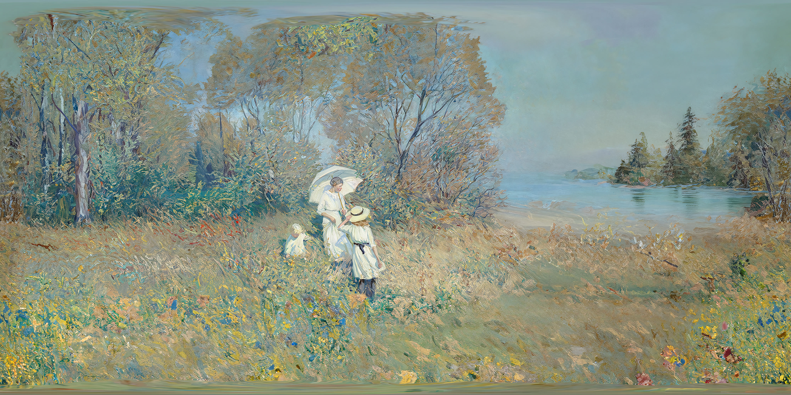

# Sunny September

### An immersive painting and sound experience



Explore an Impressionist landscape from inside a **360° sphere**. As you turn toward the trees, grasses or water, birds, wind and waves blend into the music. Switch between two recovered musical tracks and discover a different reading of the same landscape.

Originally developed during my postdoctoral research, this project explores the relationship between music, AI-extended paintings and interactive experiences. The visual starting point is *Sunny September* (1913), by **Helen McNicoll**.

## The experience

- **Look around:** drag with a mouse or one finger; use the arrow keys on a keyboard.
- **Listen:** click **Commencer l’expérience** to start the sound.
- **Change the music:** choose **A** or **B**; the environmental sounds follow your viewing direction.
- **Explore at your pace:** pause, adjust the volume, zoom with the wheel or `+` / `−`, recenter or enable **Promenade** for a slow automatic turn.
- **Immerse yourself:** use full screen and headphones.

The viewer simulates a spherical environment from one fixed viewpoint. The panorama is a painting projected onto the inside of a sphere; it does not provide movement through a reconstructed 3D landscape.

## Project history

| Period | Preserved material |
| --- | --- |
| 2023 | A recovered Glitch backup dated December 20, 2023 contains an A-Frame sphere experiment and references to a flying hummingbird. A related Mattercraft project also survives. |
| 2024 | The Git history records work on the horizontal panorama and interactive sound prototype on [May 22, 2024](https://github.com/RominaSR/ai-music-image-web-panorama/commit/3ab8360760dbe22750635668552387d3deab34a7). |
| 2025 | The last existing Glitch checkpoint in this repository is dated [February 20, 2025](https://github.com/RominaSR/ai-music-image-web-panorama/commit/895b05862c8c344ef7911c4c33034ee53da7612b). |
| 2026 | The sphere edition is reconstructed using the recovered Mattercraft panorama and five audio exports, with local assets replacing Glitch hosting. |

These dates describe the surviving files and Git records. They do not establish the exact date the original public website first went live. The original commit history is retained. The former application files and README are also preserved in [docs/legacy-2024](docs/legacy-2024/README.md).

## Run locally

No packages, build step, API key or external CDN are required. From this directory:

```sh
python -m http.server 8000
```

Open **http://localhost:8000** in a browser with WebGL and Web Audio enabled. Serve the folder over HTTP; opening `index.html` directly from a disk can prevent local images and audio from loading correctly.

## Publish with GitHub Pages

After merging this edition into `main`, open **Settings → Pages → Deploy from a branch**, choose **main** and **/(root)**, then save. The expected project address is:

https://rominasr.github.io/ai-music-image-web-panorama/

This is the intended Pages address, not a claim that deployment is already active. All runtime paths are relative, including the audio and panorama, so publication under the repository subpath works.

## Implementation

The app uses native WebGL to display the inside of the panorama sphere and Web Audio gain nodes to mix streaming audio. Environmental gains use normalized circular weights so the mix remains continuous across the 0° / 360° boundary. Playback starts only after a click and pauses when the page is hidden. Large clock drift between tracks of equal duration is corrected periodically.

The 7680 × 3840 source image is exported as a 4096 × 2048 JPEG for the web. Five stereo WAV files are converted to MP3 without changing their musical content. See [the recovery notes](docs/RECOVERY.md) for the exact sources and verification limits.

## Credits and media

**Project:** CRIUGM Montréal. **Source painting:** Helen McNicoll, *Sunny September*, 1913, Collection Pierre Lassonde. **Panorama:** recovered AI-extended image from the 2023's project. **Audio:** five recovered exports supplied with the project.

The existing [MIT license](LICENSE) covers the code. Artwork, audio recordings and other third-party materials retain their respective rights; their inclusion does not grant a separate reuse license. The recovered GLB objects and additional recordings are not part of this sphere edition.
